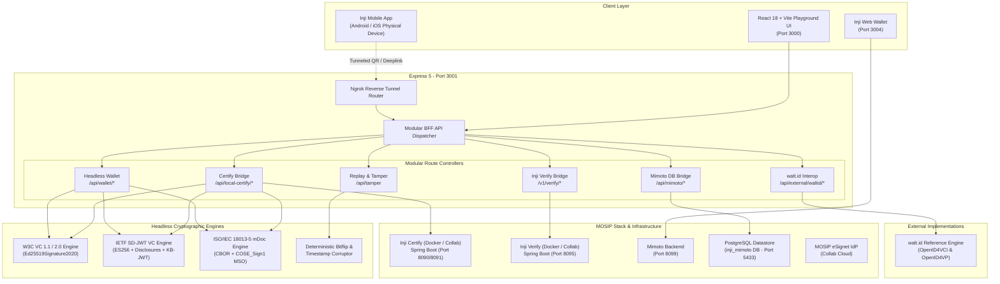

# Inji Interoperability Playground

An automated, cross-platform interoperability testing playground, protocol inspector, and conformance sandbox for Verifiable Credentials across the **MOSIP Inji ecosystem** (Inji Certify, Inji Wallet Mobile, Inji Web, Inji Verify, and external standards implementations such as walt.id).

---

## Key Documentation Artifacts

In accordance with the **MOSIP Decode 2026 Submission Guidelines**, comprehensive technical documentation is provided:

* **[API Documentation](docs/API_DOCUMENTATION.md)** (*Mandatory Deliverable*): Complete reference for all 20+ BFF endpoints (OpenID4VCI discovery, pre-authorized code token exchange, proof-of-possession verification, Inji Certify bridge, headless wallet, tamper engine, and telemetry).
* **[Test Data Catalog](docs/TEST_DATA.md)** (*Submission Guideline*): Full catalog of resident personas (Molleti Tatwik Sai UIN: `6207495860`, Gorge Cooper Farmer ID: `2154189532`, Driving License `KA-2024-998822`), cryptographic `did:key` vectors, mock OTPs, sample wire payloads across all 4 credential formats, and tampering vectors.
* **[Test Cases & Results](docs/TEST_CASES_AND_RESULTS.md)** (*Submission Guideline*): Comprehensive test matrix containing 27 formal test cases across OpenID4VCI issuance, OpenID4VP verification, negative tampering paths, mobile QR flows, and cross-ecosystem walt.id verification with a 100% pass rate.
* **[Interoperability Report & Upstream Gaps](docs/INTEROPERABILITY_REPORT.md)**: Full compliance matrix across all 4 credential formats, negative testing validation, and 6 documented upstream MOSIP ecosystem friction points with concrete architectural solutions.
* **[Ecosystem Architecture & Sequence Flows](docs/inji_ecosystem_flow.md)**: In-depth technical specifications and sequence flows for OpenID4VCI (draft 13/15), OpenID4VP (draft 21-23 / DCQL v2), and ISO 18013-5 mDoc protocols.

---

## System Architecture



---

## Repository Hierarchy

```text
inji-playground/
├── docs/                                # Core hackathon deliverables & specifications
│   ├── API_DOCUMENTATION.md             # Complete REST API & protocol reference
│   ├── TEST_DATA.md                     # Test personas, keys, schemas, & tamper vectors
│   ├── TEST_CASES_AND_RESULTS.md        # Comprehensive 27-test matrix & results
│   ├── INTEROPERABILITY_REPORT.md       # Upstream findings & format compliance matrix
│   └── inji_ecosystem_flow.md           # Mermaid sequence diagrams & protocol specs
├── mosip-stack/                         # Local MOSIP Docker infrastructure
│   ├── docker-compose.yaml              # Compose manifest (Postgres, Certify, Verify, Mimoto)
│   └── config/                          # Issuer & verifier configuration mounts
├── server/                              # Modular Express BFF & Headless Engines
│   ├── formats/                         # Cryptographic format encoders & decoders
│   │   ├── ldp.ts                       # W3C VC 1.1 / 2.0 (Ed25519Signature2020)
│   │   ├── sd-jwt.ts                    # IETF SD-JWT VC (draft-ietf-oauth-sd-jwt-vc)
│   │   └── mdoc.ts                      # ISO/IEC 18013-5 mDoc (CBOR / COSE_Sign1)
│   ├── routes/                          # Modular domain controllers
│   │   ├── certify-routes.ts            # Certify router & delegation
│   │   ├── certify/                     # Metadata caching & mock issuance engine
│   │   ├── mimoto-routes.ts             # Mimoto router & delegation
│   │   ├── mimoto/                      # DB bridge, PDF generator, presentation bridge
│   │   ├── verify-routes.ts             # Inji Verify proxy & DCQL query engine
│   │   ├── wallet-routes.ts             # Headless wallet execution endpoints
│   │   ├── telemetry-routes.ts          # Run metrics & event bus
│   │   └── proxy-routes.ts              # Collab CORS bypass proxies
│   ├── wallet/                          # Headless holder engine
│   │   ├── issuance.ts                  # Automated OpenID4VCI walk
│   │   ├── presentation.ts              # OpenID4VP presentation signer
│   │   ├── storage.ts                   # In-memory & persisted credential store
│   │   └── types.ts                     # Core wallet domain interfaces
│   ├── external/                        # External reference implementation bridges
│   │   ├── waltid-issuer.ts             # walt.id OpenID4VCI issuer bridge
│   │   └── waltid-verifier.ts           # walt.id OpenID4VP verifier bridge
│   ├── tamper.ts                        # Deterministic corruption & mutation engine
│   ├── keys.ts                          # DID:key and JWK generators (Ed25519, P-256)
│   ├── endpoints.ts                     # Upstream service registry
│   └── index.ts                         # Express server bootstrap (Port 3001)
├── src/                                 # Frontend React 18 Application (Vite, port 3000)
│   ├── components/                      # Modular UI components
│   │   ├── layout/                      # Header, Navigation, Status badges
│   │   ├── config/                      # 3-Column RoleSelector (Issuer → Wallet → Verifier)
│   │   ├── flow/                        # SequenceDiagram, FlowProgress, InteractiveAuthModal
│   │   ├── verification/                # InjiVerifyPanel (Official SDK integration)
│   │   ├── reporting/                   # RunHistory, InteropMatrix, TestReport, InspectorModal
│   │   └── index.ts                     # Central barrel export
│   ├── store/                           # Reactive state management
│   │   ├── store.ts                     # Zustand store definition
│   │   └── flow-runner.ts               # Protocol step execution engine
│   ├── config.ts                        # Credential schemas & entity profiles
│   └── history-data.ts                  # Multi-release baseline regression test dataset
└── scripts/
    ├── check-suite.ts                   # Headless format signature conformance runner
    └── check-issuance.ts                # End-to-end OpenID4VCI draft-13 conformance test
```

---

## Quick Startup Guide

### Prerequisites
* **Node.js**: v18+ (tested on v20 & v24 LTS)
* **npm**: v9+
* **Docker & Docker Compose**: Ensure Docker daemon is running (optional if testing against Collab Sandbox).

---

### Step 1: Install Dependencies
```bash
npm install
```

---

### Step 2: (Optional) Start Local MOSIP Docker Stack
If testing against local containerized MOSIP services instead of the Collab sandbox:
```bash
cd mosip-stack
docker compose up -d
cd ..
```
*Spins up PostgreSQL (port 5433), Inji Certify (port 8090/8091), Mimoto (port 8099), Inji Verify (port 8095), and Inji Web (port 3004).*

---

### Step 3: Launch the Playground Application
Run both the backend BFF orchestrator and the Vite frontend concurrently:
```bash
npm run dev:all
```
* Open your browser at **[http://localhost:3000](http://localhost:3000)**.
* Backend API runs on **[http://localhost:3001](http://localhost:3001)**.

---

### Alternative: One-Command Docker Compose Bundle
To launch the complete playground (BFF orchestrator, production-optimized React SPA, and automated health checks) in a single command:
```bash
docker compose up --build
```
* Open your browser at **[http://localhost:3001](http://localhost:3001)** (Express BFF serves the production SPA from `dist/` and routes all API endpoints).

---

### Live Sandbox Diagnostics & Upstream Health Probes
To check the real-time connectivity and latency of upstream Collab sandbox endpoints (Certify, Verify, eSignet) and local databases:
```bash
curl http://localhost:3001/api/diagnostics
```

---

## Physical Mobile Wallet Testing (Inji Mobile Android / iOS)

To issue credentials directly to or verify credentials from a physical smartphone running the **Inji Mobile Wallet** app:

1. **Start an Ngrok Tunnel** exposing port 3001:
   ```bash
   ngrok http 3001
   ```
2. **Sync the Tunnel URL** in the playground UI header or via API:
   ```bash
   curl -X POST http://localhost:3001/api/tunnel \
     -H "Content-Type: application/json" \
     -d '{"tunnelUrl":"https://<your-subdomain>.ngrok-free.dev"}'
   ```
3. **Configure the Inji Mobile App**:
   * Open Settings $\rightarrow$ Advanced / Developer Options.
   * **eSignet Host:** `https://esignet-mosipid.collab.mosip.net`
   * **Credential Registry:** Your Ngrok public URL.
4. **Scan the Generated QR Code** directly from the playground UI to trigger issuance or verification.

---

## Automated Conformance Test Suites

Run the headless cryptographic, protocol conformance, and unit test suites:

### 1. Automated Unit Test Runner
Runs native unit tests validating format encoders, `did:key` cryptographic derivation, and deterministic tampering:
```bash
npm test
```

### 2. Multi-Format Cryptographic Conformance Suite
Verifies W3C VC 1.1, W3C VC 2.0, IETF SD-JWT, and ISO 18013-5 mDoc signatures locally and against live Collab Inji Verify:
```bash
npm run check:suite
```

### 3. End-to-End OpenID4VCI Draft-13 Conformance Suite
Exercises the full 7-step issuance flow, proof-of-possession validation, and negative rejection paths:
```bash
npx tsx scripts/check-issuance.ts
```

### 4. Full Quality & Conformance Pipeline
Runs static typecheck, unit tests, and live multi-format conformance checks in sequence:
```bash
npm run test:all
```

### 5. Static Typecheck, Lint & Build Validation
```bash
npm run typecheck
npm run lint
npm run build
```

---

## Continuous Integration (CI)

The repository includes an automated GitHub Actions workflow (`.github/workflows/ci.yml`) providing:
* Automated static type checking (`tsc -b`), code linting (`oxlint`), and unit testing on every push and pull request.
* Nightly scheduled conformance tests against the MOSIP Collab Cloud Sandbox to detect upstream regressions.
* Multi-platform validation across Node.js 20 LTS.
