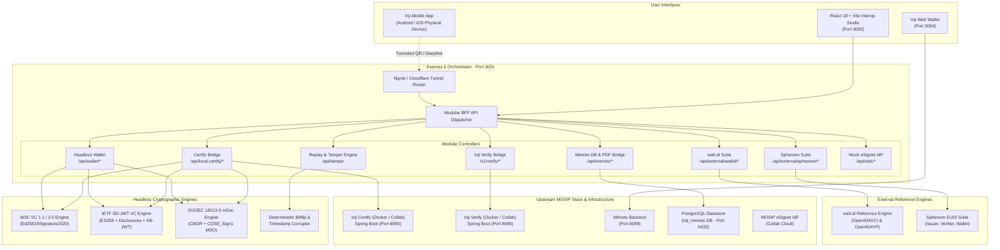
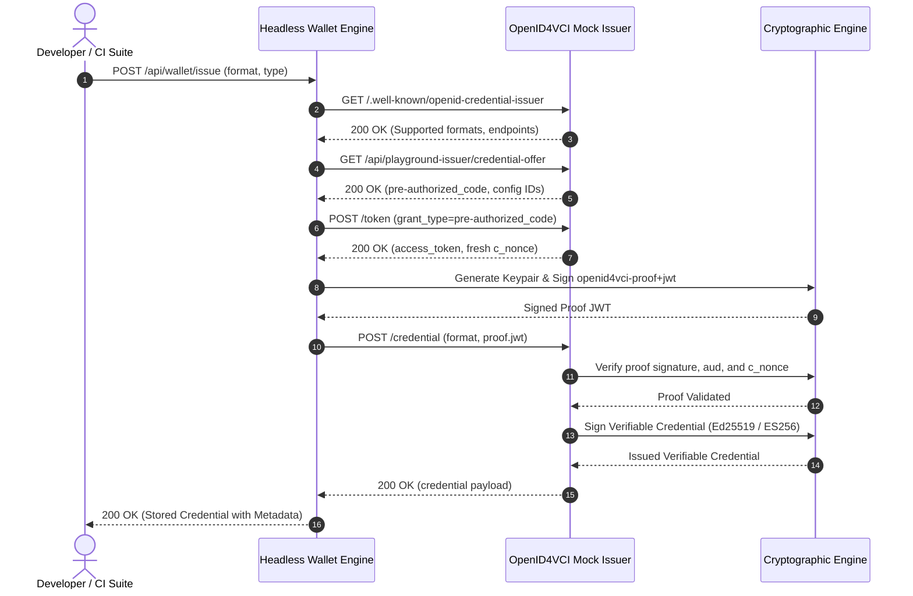
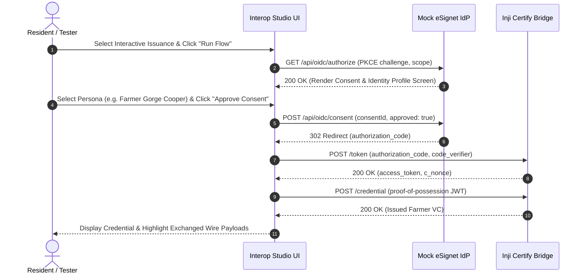
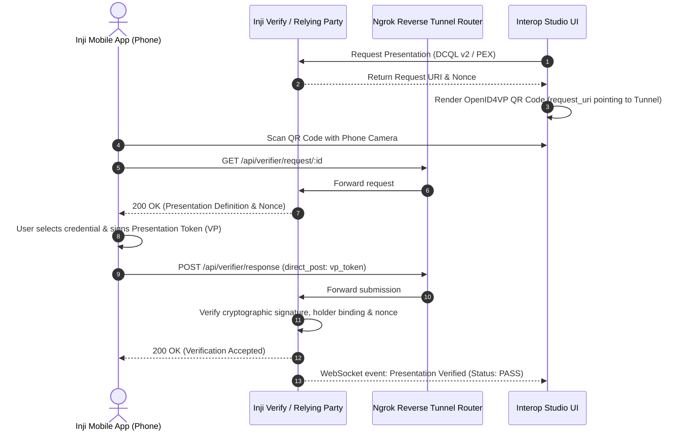
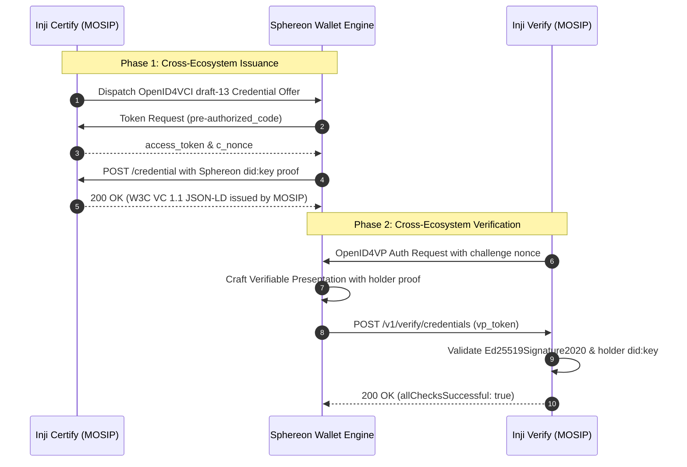
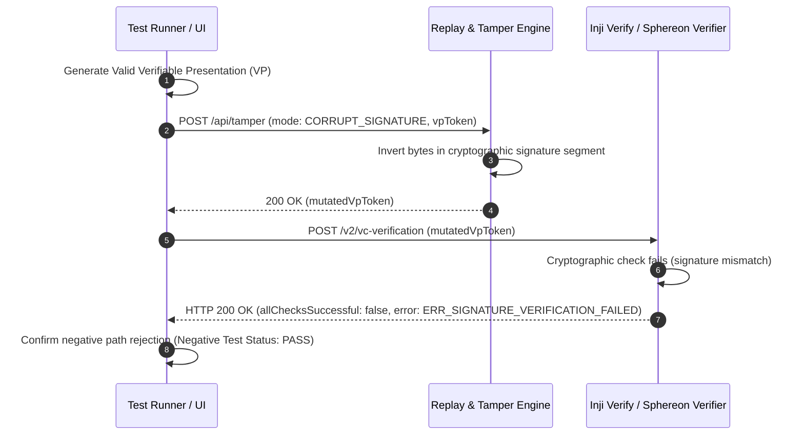
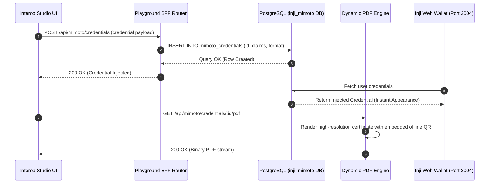

# MOSIP Inji Interoperability Playground: Architecture & Protocol Sequence Flows

> **Specification Standards:** OpenID4VCI (draft 13/15), OpenID4VP (draft 21-23 / DCQL v2), W3C VC 1.1 / 2.0 (JSON-LD), IETF SD-JWT VC (`draft-ietf-oauth-sd-jwt-vc`), ISO/IEC 18013-5 mDoc.

This document details the system architecture, component boundaries, and Mermaid protocol sequence flows for the **Inji Interoperability Playground**.

---

## Table of Contents
1. [High-Level System Architecture](#1-high-level-system-architecture)
2. [OpenID4VCI Issuance Protocol Flows](#2-openid4vci-issuance-protocol-flows)
3. [OpenID4VP Presentation & Verification Flows](#3-openid4vp-presentation--verification-flows)
4. [Cross-Ecosystem Interoperability Sequences (Sphereon & walt.id)](#4-cross-ecosystem-interoperability-sequences-sphereon--waltid)
5. [Negative Testing & Replay/Tamper Sequence](#5-negative-testing--replaytamper-sequence)
6. [Mimoto DB Injection & Dynamic PDF Generation](#6-mimoto-db-injection--dynamic-pdf-generation)

---

## 1. High-Level System Architecture

---

## 2. OpenID4VCI Issuance Protocol Flows

### 2.1 Automated Pre-Authorized Code Grant Flow (Draft 13/15)

---

### 2.2 Interactive Authorization Code Flow with eSignet Simulation

---

## 3. OpenID4VP Presentation & Verification Flows

### 3.1 Cross-Device Flow (Physical Inji Mobile Wallet via QR & Tunnel)

---

## 4. Cross-Ecosystem Interoperability Sequences (Sphereon & walt.id)

### 4.1 Inji Certify $\rightarrow$ Sphereon Wallet $\rightarrow$ Inji Verify

---

## 5. Negative Testing & Replay/Tamper Sequence

---

## 6. Mimoto DB Injection & Dynamic PDF Generation

